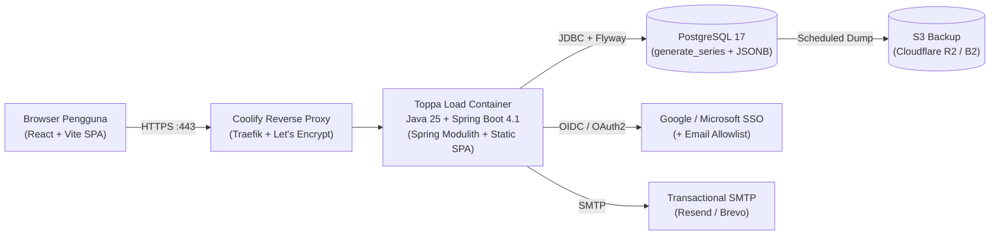

# Toppa Load

Aplikasi perencanaan beban kerja (*workload*), kapasitas bersih, cuti, dan operasional harian untuk tim internal berskala ringkas (6–10 orang: anggota tim, supervisor, dan admin).

Dirancang khusus untuk dikelola secara berkelanjutan oleh **satu developer** dengan prinsip: **satu aplikasi, satu database, satu VPS, satu jalur deploy**.

---

## Ringkasan Arsitektur



### Prinsip Desain Utama
1. **Modular Monolith Terverifikasi**: Satu artefak *deployable* dengan batas modul ketat (`identity`, `project`, `allocation`, `capacity`, `leave`, `timesheet`, `notification`, `report`) yang diverifikasi otomatis lewat `ApplicationModules.of(ToppaLoadApplication.class).verify()`.
2. **Perhitungan Kapasitas Langsung di PostgreSQL**: Alokasi diekspansi per hari kerja menggunakan `generate_series`, dikurangi libur nasional/perusahaan dan cuti yang disetujui, tanpa tabel turunan atau antrean *worker* terpisah.
3. **Antarmuka Alat Kerja Padat (*Anti-Generic UI*)**: Layar utama adalah **Heatmap Orang × Minggu** dengan angka tabular rata kanan, status ramah buta warna (persentase + pola/label, bukan warna saja), dan navigasi keyboard penuh.
4. **Privasi & Keamanan Data Karyawan**: Login wajib lewat SSO dengan *allowlist* email, otorisasi sisi server di tiap endpoint, *soft delete*, serta *audit log* berformat `JSONB` sejak hari pertama.

---

## Tech Stack

| Layer | Pilihan Teknologi | Catatan |
|---|---|---|
| **Backend** | Java 25 LTS, Spring Boot 4.1.0, Spring Modulith 2.1.0 | Heap dibatasi (`-Xmx512m`), cocok di VPS 4 GB RAM |
| **Akses Data** | Spring Data JPA (CRUD) + `JdbcClient` / Native SQL (Kapasitas) | Query agregasi eksplisit & teruji dengan Testcontainers 2.0 |
| **Database & Migrasi** | PostgreSQL 17 + Flyway | Pola migrasi *expand-contract* untuk *rollback* aman |
| **Autentikasi** | Spring Security + OAuth2/OIDC (Google/Microsoft) | Cookie `HttpOnly`, `SameSite=Lax`, CSRF aktif |
| **API & Kontrak** | REST JSON + `springdoc-openapi` 3.1.x | Spesifikasi OpenAPI 3 untuk klien TypeScript |
| **Frontend** | React 19 + TypeScript + Vite | *Code-splitting* per rute untuk modul grafik/kalender |
| **UI & Data Grid** | Radix Primitives, TanStack Query & Table, FullCalendar, ECharts | Token desain kustom, file terjemahan (`id`/`en`) sejak Fase 1 |
| **Pengujian** | JUnit 5, Testcontainers (`testcontainers-postgresql`), Playwright | Fokus pada 10 kasus tepi kapasitas & otorisasi RBAC |
| **Deploy & Ops** | Docker Multi-Stage (Opsi A: 1 Image), Coolify, GitHub Actions | Uptime Kuma, Sentry, Backup PostgreSQL harian ke S3 |

---

## Struktur Repositori

```text
toppa-load/
├── server/                 # Backend Java 25 + Spring Boot 4.1 (Maven, Spring Modulith)
├── web/                    # Frontend React + TypeScript + Vite
├── deploy/                 # Dockerfile multi-stage, docker-compose lokal, panduan Coolify
└── docs/                   # Dokumentasi produk, arsitektur, operasi, dan rencana eksekusi
    ├── prd.md              # Product Requirements Document lengkap (termasuk Bagian 7: Aturan Kapasitas)
    ├── kickoff-kit.md      # Paket siap kick-off (keputusan default, cek mesin lokal, template HR/wawancara)
    ├── roadmap-backlog.md  # Jadwal 24 minggu (Fase 1–3), DoD, dan aturan kerja solo
    ├── prompt-review.md    # Prompt kritik rencana lintas model AI & tabel keputusan review
    ├── runbook.md          # Runbook operasional 1 halaman (deploy, rollback, restore, user)
    ├── adr/                # Architecture Decision Records (ADR 0001–0005)
    └── superpowers/
        ├── specs/          # Spesifikasi desain teknis & DDL database
        └── plans/          # Rencana implementasi TDD langkah demi langkah (Fase 1 Minggu 1–7)
```

---

## Fase Pengembangan

| Fase | Minggu | Fokus Utama | Sasaran Rilis |
|---|---|---|---|
| **Fase 1** | 1–7 | Fondasi, SSO, Proyek/Task, Alokasi, Kapasitas, Libur/Cuti, Heatmap, Notifikasi Email | Dipakai nyata oleh 6 pengguna menggantikan spreadsheet alokasi & cuti |
| **Fase 2** | 8–16 | Timesheet & Timer, Kanban/Kalender/Gantt, Approval Cuti, Rebalancing Drag-and-Drop, Chat | Menjadi alat kerja harian & bahan review mingguan supervisor |
| **Fase 3** | 17–24 | Laporan Terjadwal, Forecasting *What-If*, Integrasi Terpilih, Rekomendasi AI *(Opsional)* | Diputuskan pada evaluasi Minggu 16 berdasarkan pemakaian nyata |

---

## Memulai (*Kick-Off & Local Development*)

1. Buka [`docs/kickoff-kit.md`](docs/kickoff-kit.md) untuk daftar cek kesiapan mesin lokal (JDK 25, Node 24, Docker), asumsi default 7 pertanyaan pra-*kick-off*, dan template persetujuan hosting data karyawan.
2. Jalankan infrastruktur lokal (PostgreSQL 17 + Mailpit SMTP):
   ```powershell
   docker compose -f deploy/docker-compose.dev.yml up -d
   ```
3. Ikuti rencana eksekusi langkah demi langkah mulai dari [`docs/superpowers/plans/2026-11-01-f1-01-foundation-and-deploy.md`](docs/superpowers/plans/2026-11-01-f1-01-foundation-and-deploy.md).

---

## Catatan Portfolio & Data Pribadi

- **Dilarang keras** menyimpan data karyawan asli (nama, email perusahaan, jadwal cuti nyata) di dalam kode sumber, *seed* migrasi, maupun *fixture* pengujian. Seluruh pengujian menggunakan data sintetis.
- Jika kode dipublikasikan sebagai portfolio publik, pastikan persetujuan tertulis perusahaan telah diperoleh atau publikasikan dari repositori *demo generik* yang terpisah dari instansi internal.

