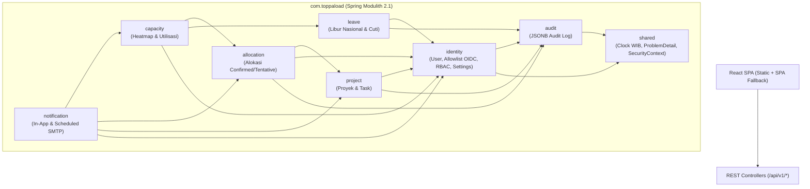

# Spesifikasi Desain Teknis — Toppa Load (v1.3)

**Tanggal:** 2026-11-01  
**Status:** Disetujui untuk Eksekusi Kick-Off (Menggunakan Keputusan Default Builder untuk Item Terbuka)  
**Rujukan Produk:** [`docs/prd.md`](../../prd.md) · **Keputusan Arsitektur:** [`docs/adr/`](../../adr/)

---

## 1. Tujuan Desain & Batasan Sistem

Membangun aplikasi web internal perencanaan beban kerja (*workload*), kapasitas bersih, cuti, dan operasional harian untuk **1 tim internal (6–7 akun aktif, zona waktu kerja WIB `Asia/Jakarta`)** yang dapat dibangun, di-deploy, dan dipelihara sendirian oleh **1 developer**.

### Batasan Keras (*Global Constraints*)
- **Runtime & Framework Backend:** Java `25` LTS, Spring Boot `4.1.0`, Spring Modulith `2.1.0`, `springdoc-openapi-starter-webmvc-ui` `3.1.1`, Maven Wrapper (`mvnw`) satu modul di folder `server/`.
- **Database & Migrasi:** PostgreSQL `17`, Flyway migrasi berversi pola *expand-contract*, pengujian integrasi wajib menggunakan Testcontainers `2.0.3` (`org.testcontainers:testcontainers-postgresql`).
- **Frontend:** React `19`, TypeScript `5.x`, Vite `6+`, Tailwind CSS `v4` dengan token CSS alat kerja kustom, Radix UI Headless Primitives, TanStack Query `v5`, TanStack Table `v8`, `i18next` (`id` aktif sejak Fase 1, struktur `en` siap untuk Fase 3) di folder `web/`.
- **Deployment:** Opsi A — Satu image Docker multi-stage (`deploy/Dockerfile`) menyajikan API `/api/v1/**` dan bundel SPA React dari origin yang sama di Coolify VPS (2 vCPU, 4 GB RAM, JVM `-Xmx512m`).
- **Waktu & Kalender:** Semua timestamp audit/sistem disimpan sebagai `TIMESTAMPTZ` (UTC); semua tanggal kalender kerja (`start_date`, `end_date`, `holiday_date`, `due_date`) disimpan sebagai `DATE` mengikuti kalender kerja **WIB (`Asia/Jakarta`)**.

---

## 2. Topologi Modul Backend (Spring Modulith)

Root package: `com.toppaload`



### Aturan Batas Modul (`@ApplicationModule`)
- Setiap modul mengekspos DTO/Record dan Facade Service publik di root paket modulnya (mis. `com.toppaload.identity.UserDirectory`, `com.toppaload.audit.AuditRecorder`), sedangkan Entity JPA, Repository, dan Controller berada di `com.toppaload.<modul>.internal`.
- **Dilarang keras** ada siklus ketergantungan antar modul. Test `ModularityTests` menjalankan `ApplicationModules.of(ToppaLoadApplication.class).verify()` pada setiap build CI.

---

## 3. Skema Database PostgreSQL 17 (Fase 1 Baseline + Ekstensi Fase 2)

Seluruh tabel inti memiliki UUID primary key (`gen_random_uuid()`), timestamp UTC (`created_at`, `updated_at`), dan *soft delete* (`deleted_at TIMESTAMPTZ NULL`) untuk entitas bisnis utama.

```sql
-- 1. users (Allowlist SSO & Profil Kapasitas Kerja)
CREATE TABLE users (
    id                  UUID PRIMARY KEY DEFAULT gen_random_uuid(),
    email               VARCHAR(255) NOT NULL,
    full_name           VARCHAR(150) NOT NULL,
    role                VARCHAR(20)  NOT NULL CHECK (role IN ('ADMIN', 'SUPERVISOR', 'MEMBER')),
    work_hours_per_day  NUMERIC(4,2) NOT NULL DEFAULT 8.00 CHECK (work_hours_per_day > 0 AND work_hours_per_day <= 24),
    work_days           SMALLINT[]   NOT NULL DEFAULT '{1,2,3,4,5}', -- ISO DOW: 1=Sen .. 7=Min
    active              BOOLEAN      NOT NULL DEFAULT TRUE,
    email_notifications BOOLEAN      NOT NULL DEFAULT TRUE,
    created_at          TIMESTAMPTZ  NOT NULL DEFAULT NOW(),
    updated_at          TIMESTAMPTZ  NOT NULL DEFAULT NOW(),
    deleted_at          TIMESTAMPTZ
);
CREATE UNIQUE INDEX uq_users_email_lower ON users (LOWER(email)) WHERE deleted_at IS NULL;

-- 2. system_settings (Baris tunggal konfigurasi tim, mis. ambang utilisasi)
CREATE TABLE system_settings (
    id                         SMALLINT PRIMARY KEY DEFAULT 1 CHECK (id = 1),
    underutilized_threshold_pct NUMERIC(5,1) NOT NULL DEFAULT 60.0,
    overloaded_threshold_pct    NUMERIC(5,1) NOT NULL DEFAULT 100.0,
    work_timezone              VARCHAR(64)  NOT NULL DEFAULT 'Asia/Jakarta',
    updated_by                 UUID REFERENCES users(id),
    updated_at                 TIMESTAMPTZ  NOT NULL DEFAULT NOW(),
    CHECK (underutilized_threshold_pct >= 0 AND underutilized_threshold_pct < overloaded_threshold_pct)
);

-- 3. projects
CREATE TABLE projects (
    id          UUID PRIMARY KEY DEFAULT gen_random_uuid(),
    code        VARCHAR(24)  NOT NULL,
    name        VARCHAR(160) NOT NULL,
    description TEXT,
    status      VARCHAR(20)  NOT NULL DEFAULT 'ACTIVE'
                CHECK (status IN ('PLANNING', 'ACTIVE', 'ON_HOLD', 'COMPLETED', 'ARCHIVED')),
    start_date  DATE         NOT NULL,
    end_date    DATE         NOT NULL,
    owner_id    UUID         NOT NULL REFERENCES users(id),
    created_at  TIMESTAMPTZ  NOT NULL DEFAULT NOW(),
    updated_at  TIMESTAMPTZ  NOT NULL DEFAULT NOW(),
    deleted_at  TIMESTAMPTZ,
    CHECK (end_date >= start_date)
);
CREATE UNIQUE INDEX uq_projects_code_upper ON projects (UPPER(code)) WHERE deleted_at IS NULL;

-- 4. tasks
CREATE TABLE tasks (
    id              UUID PRIMARY KEY DEFAULT gen_random_uuid(),
    project_id      UUID         NOT NULL REFERENCES projects(id),
    title           VARCHAR(200) NOT NULL,
    description     TEXT,
    status          VARCHAR(20)  NOT NULL DEFAULT 'TODO'
                    CHECK (status IN ('TODO', 'IN_PROGRESS', 'DONE', 'CANCELLED')),
    priority        VARCHAR(16)  NOT NULL DEFAULT 'MEDIUM'
                    CHECK (priority IN ('LOW', 'MEDIUM', 'HIGH', 'URGENT')),
    estimated_hours NUMERIC(6,2) CHECK (estimated_hours IS NULL OR estimated_hours >= 0),
    due_date        DATE,
    labels          TEXT[]       NOT NULL DEFAULT '{}',
    created_at      TIMESTAMPTZ  NOT NULL DEFAULT NOW(),
    updated_at      TIMESTAMPTZ  NOT NULL DEFAULT NOW(),
    deleted_at      TIMESTAMPTZ
);
CREATE INDEX idx_tasks_project_status ON tasks (project_id, status) WHERE deleted_at IS NULL;
CREATE INDEX idx_tasks_due_date ON tasks (due_date) WHERE deleted_at IS NULL AND status NOT IN ('DONE', 'CANCELLED');

-- 5. allocations
CREATE TABLE allocations (
    id              UUID PRIMARY KEY DEFAULT gen_random_uuid(),
    user_id         UUID         NOT NULL REFERENCES users(id),
    project_id      UUID         NOT NULL REFERENCES projects(id),
    task_id         UUID         REFERENCES tasks(id),
    start_date      DATE         NOT NULL,
    end_date        DATE         NOT NULL,
    hours_per_day   NUMERIC(4,2) NOT NULL CHECK (hours_per_day > 0 AND hours_per_day <= 24),
    allocation_type VARCHAR(16)  NOT NULL DEFAULT 'CONFIRMED'
                    CHECK (allocation_type IN ('CONFIRMED', 'TENTATIVE')),
    notes           VARCHAR(500),
    created_by      UUID         NOT NULL REFERENCES users(id),
    created_at      TIMESTAMPTZ  NOT NULL DEFAULT NOW(),
    updated_at      TIMESTAMPTZ  NOT NULL DEFAULT NOW(),
    deleted_at      TIMESTAMPTZ,
    CHECK (end_date >= start_date)
);
CREATE INDEX idx_allocations_user_dates ON allocations (user_id, start_date, end_date) WHERE deleted_at IS NULL;
CREATE INDEX idx_allocations_project_dates ON allocations (project_id, start_date, end_date) WHERE deleted_at IS NULL;

-- 6. holidays (Libur Nasional & Cuti Bersama Perusahaan)
CREATE TABLE holidays (
    id           UUID PRIMARY KEY DEFAULT gen_random_uuid(),
    holiday_date DATE         NOT NULL,
    name         VARCHAR(160) NOT NULL,
    scope        VARCHAR(16)  NOT NULL DEFAULT 'NATIONAL'
                 CHECK (scope IN ('NATIONAL', 'COMPANY')),
    created_at   TIMESTAMPTZ  NOT NULL DEFAULT NOW(),
    updated_at   TIMESTAMPTZ  NOT NULL DEFAULT NOW(),
    deleted_at   TIMESTAMPTZ
);
CREATE UNIQUE INDEX uq_holidays_date_scope ON holidays (holiday_date, scope) WHERE deleted_at IS NULL;

-- 7. leaves (Cuti Anggota Tim — Penuh & Setengah Hari)
CREATE TABLE leaves (
    id          UUID PRIMARY KEY DEFAULT gen_random_uuid(),
    user_id     UUID         NOT NULL REFERENCES users(id),
    leave_type  VARCHAR(20)  NOT NULL CHECK (leave_type IN ('ANNUAL', 'SICK', 'UNPAID', 'OTHER')),
    portion     VARCHAR(16)  NOT NULL DEFAULT 'FULL' CHECK (portion IN ('FULL', 'HALF_AM', 'HALF_PM')),
    start_date  DATE         NOT NULL,
    end_date    DATE         NOT NULL,
    status      VARCHAR(16)  NOT NULL DEFAULT 'APPROVED'
                CHECK (status IN ('PENDING', 'APPROVED', 'REJECTED', 'CANCELLED')),
    reason      VARCHAR(500),
    approver_id UUID         REFERENCES users(id),
    created_at  TIMESTAMPTZ  NOT NULL DEFAULT NOW(),
    updated_at  TIMESTAMPTZ  NOT NULL DEFAULT NOW(),
    deleted_at  TIMESTAMPTZ,
    CHECK (end_date >= start_date),
    CHECK (portion = 'FULL' OR start_date = end_date) -- Cuti setengah hari berlaku untuk 1 tanggal spesifik
);
CREATE INDEX idx_leaves_user_dates ON leaves (user_id, start_date, end_date) WHERE deleted_at IS NULL AND status = 'APPROVED';

-- 8. notifications (In-App + Status Pengiriman Email Anti-Dobel)
CREATE TABLE notifications (
    id              UUID PRIMARY KEY DEFAULT gen_random_uuid(),
    user_id         UUID         NOT NULL REFERENCES users(id),
    type            VARCHAR(40)  NOT NULL
                    CHECK (type IN ('ALLOCATION_ASSIGNED', 'TASK_DUE_SOON', 'OVERLOAD_WARNING', 'LEAVE_STATUS')),
    title           VARCHAR(200) NOT NULL,
    payload         JSONB        NOT NULL DEFAULT '{}'::jsonb,
    dedup_key       VARCHAR(160) NOT NULL UNIQUE, -- Kunci idempotensi agar job terjadwal tidak pernah kirim dobel
    read_at         TIMESTAMPTZ,
    email_status    VARCHAR(16)  NOT NULL DEFAULT 'PENDING'
                    CHECK (email_status IN ('PENDING', 'SENT', 'SKIPPED', 'FAILED')),
    email_sent_at   TIMESTAMPTZ,
    email_error     VARCHAR(500),
    created_at      TIMESTAMPTZ  NOT NULL DEFAULT NOW()
);
CREATE INDEX idx_notifications_user_unread ON notifications (user_id, created_at DESC) WHERE read_at IS NULL;
CREATE INDEX idx_notifications_email_pending ON notifications (email_status, created_at) WHERE email_status = 'PENDING';

-- 9. audit_logs (Append-Only Jejak Audit JSONB)
CREATE TABLE audit_logs (
    id          UUID PRIMARY KEY DEFAULT gen_random_uuid(),
    actor_id    UUID         REFERENCES users(id),
    actor_email VARCHAR(255) NOT NULL,
    action      VARCHAR(40)  NOT NULL, -- CREATE, UPDATE, DELETE, IMPORT, LOGIN_DENIED
    entity_type VARCHAR(40)  NOT NULL, -- USER, PROJECT, TASK, ALLOCATION, LEAVE, HOLIDAY, SETTINGS
    entity_id   VARCHAR(64)  NOT NULL,
    before_data JSONB,
    after_data  JSONB,
    occurred_at TIMESTAMPTZ  NOT NULL DEFAULT NOW()
);
CREATE INDEX idx_audit_logs_entity ON audit_logs (entity_type, entity_id, occurred_at DESC);
CREATE INDEX idx_audit_logs_occurred ON audit_logs (occurred_at DESC);
```

> **Ekstensi Skema Fase 2 (Migrasi `V2`–`V4` saat Minggu 8 & 12):** Menambahkan `time_entries` (termasuk status minggu `timesheet_submissions`), `skills`, `user_skills`, `leave_balances`, dan `task_comments` secara *additive* tanpa mengubah kolom Fase 1.

---

## 4. Algoritma SQL Kapasitas & Utilisasi (`generate_series`)

Dieksekusi melalui `JdbcClient` di `com.toppaload.capacity.internal.JdbcCapacityQueryRepository`:

```sql
WITH calendar_days AS (
    SELECT gs::date AS work_date,
           CASE :granularity
               WHEN 'DAY'   THEN gs::date
               WHEN 'MONTH' THEN date_trunc('month', gs)::date
               ELSE              date_trunc('week', gs)::date -- ISO Week (Senin)
           END AS bucket_start
    FROM generate_series(:fromDate::date, :toDate::date, interval '1 day') AS gs
),
holiday_dates AS (
    SELECT DISTINCT holiday_date
    FROM holidays
    WHERE deleted_at IS NULL
      AND holiday_date BETWEEN :fromDate::date AND :toDate::date
),
daily_user_grid AS (
    SELECT u.id AS user_id,
           u.full_name,
           u.role,
           cd.work_date,
           cd.bucket_start,
           (EXTRACT(ISODOW FROM cd.work_date)::smallint = ANY(u.work_days)) AS is_workday,
           (hd.holiday_date IS NOT NULL) AS is_holiday,
           CASE
               WHEN (EXTRACT(ISODOW FROM cd.work_date)::smallint = ANY(u.work_days))
                    AND hd.holiday_date IS NULL
               THEN u.work_hours_per_day
               ELSE 0.00
           END AS base_hours,
           u.work_hours_per_day
    FROM users u
    CROSS JOIN calendar_days cd
    LEFT JOIN holiday_dates hd ON hd.holiday_date = cd.work_date
    WHERE u.active = TRUE
      AND u.deleted_at IS NULL
),
daily_leaves AS (
    SELECT l.user_id,
           gs::date AS work_date,
           SUM(
               CASE
                   WHEN l.portion = 'FULL' THEN 1.0
                   ELSE 0.5
               END
           ) AS leave_day_fraction
    FROM leaves l
    CROSS JOIN LATERAL generate_series(
        GREATEST(l.start_date, :fromDate::date),
        LEAST(l.end_date, :toDate::date),
        interval '1 day'
    ) AS gs
    WHERE l.deleted_at IS NULL
      AND l.status = 'APPROVED'
      AND l.start_date <= :toDate::date
      AND l.end_date >= :fromDate::date
    GROUP BY l.user_id, gs::date
),
daily_allocations AS (
    SELECT a.user_id,
           gs::date AS work_date,
           COALESCE(SUM(a.hours_per_day) FILTER (WHERE a.allocation_type = 'CONFIRMED'), 0.00) AS confirmed_raw,
           COALESCE(SUM(a.hours_per_day) FILTER (WHERE a.allocation_type = 'TENTATIVE'), 0.00) AS tentative_raw
    FROM allocations a
    CROSS JOIN LATERAL generate_series(
        GREATEST(a.start_date, :fromDate::date),
        LEAST(a.end_date, :toDate::date),
        interval '1 day'
    ) AS gs
    WHERE a.deleted_at IS NULL
      AND a.start_date <= :toDate::date
      AND a.end_date >= :fromDate::date
    GROUP BY a.user_id, gs::date
),
daily_effective AS (
    SELECT g.user_id,
           g.full_name,
           g.role,
           g.work_date,
           g.bucket_start,
           g.base_hours,
           LEAST(g.base_hours, ROUND(COALESCE(dl.leave_day_fraction, 0) * g.work_hours_per_day, 2)) AS leave_hours,
           GREATEST(0.00, g.base_hours - LEAST(g.base_hours, ROUND(COALESCE(dl.leave_day_fraction, 0) * g.work_hours_per_day, 2))) AS net_capacity_hours,
           CASE WHEN g.is_workday AND NOT g.is_holiday THEN COALESCE(da.confirmed_raw, 0.00) ELSE 0.00 END AS confirmed_hours,
           CASE WHEN g.is_workday AND NOT g.is_holiday THEN COALESCE(da.tentative_raw, 0.00) ELSE 0.00 END AS tentative_hours
    FROM daily_user_grid g
    LEFT JOIN daily_leaves dl ON dl.user_id = g.user_id AND dl.work_date = g.work_date
    LEFT JOIN daily_allocations da ON da.user_id = g.user_id AND da.work_date = g.work_date
)
SELECT user_id,
       full_name,
       role,
       bucket_start,
       SUM(net_capacity_hours) AS net_capacity_hours,
       SUM(leave_hours)        AS leave_hours,
       SUM(confirmed_hours)    AS confirmed_hours,
       SUM(tentative_hours)    AS tentative_hours,
       BOOL_OR(leave_hours > 0 AND confirmed_hours > net_capacity_hours) AS has_leave_conflict
FROM daily_effective
GROUP BY user_id, full_name, role, bucket_start
ORDER BY full_name ASC, bucket_start ASC;
```

Klasifikasi status (`UNDERUTILIZED`, `OPTIMAL`, `OVERLOADED`, `NO_CAPACITY`) dihitung secara deterministik di kelas domain murni `CapacityClassifier` menggunakan ambang dari `system_settings`, sehingga baik unit test murni maupun integration test SQL dapat menguji seluruh aturan secara terpisah dan terpadu.

---

## 5. Kontrak REST API Fase 1 (`/api/v1`)

Seluruh respons error menggunakan format standar **RFC 7807 (`application/problem+json`)** dengan pesan Bahasa Indonesia yang menjelaskan penyebab dan langkah perbaikan.

| Modul | Method & Path | Role Minimum | Deskripsi |
|---|---|---|---|
| **System** | `GET /api/v1/system/info` | Publik | Versi aplikasi, zona waktu kerja, provider SSO aktif |
| **Auth/Me** | `GET /api/v1/me` | Authenticated | Profil user login, role, CSRF token aktif |
| **Users** | `GET /api/v1/users` | Authenticated | Daftar anggota tim aktif & jadwal jam/hari kerja |
| **Users** | `POST /api/v1/users` | `ADMIN` | Tambah email ke allowlist SSO |
| **Users** | `PATCH /api/v1/users/{id}` | `ADMIN` *(atau `SUPERVISOR` khusus jam kerja)* | Ubah role, `workHoursPerDay`, `workDays`, status `active` |
| **Settings** | `GET /api/v1/settings` / `PUT /api/v1/settings` | Authenticated / `ADMIN` | Baca / ubah ambang `underutilized` & `overloaded` |
| **Projects** | `GET /api/v1/projects` | Authenticated | Daftar proyek dengan filter `status` & `q` |
| **Projects** | `POST /api/v1/projects` / `PUT /api/v1/projects/{id}` / `DELETE /api/v1/projects/{id}` | `SUPERVISOR` | Buat, ubah, soft-delete proyek |
| **Tasks** | `GET /api/v1/projects/{projectId}/tasks` | Authenticated | Daftar task proyek dengan filter `status`, `priority`, `q` |
| **Tasks** | `POST /api/v1/projects/{projectId}/tasks` / `PUT /api/v1/tasks/{id}` / `DELETE /api/v1/tasks/{id}` | `MEMBER` *(proyek terkait)* / `SUPERVISOR` | CRUD task dalam `< 2 menit` (mendukung quick-add baris) |
| **Allocations** | `GET /api/v1/allocations` | Authenticated | Filter berdasarkan `userId`, `projectId`, `from`, `to` |
| **Allocations** | `POST /api/v1/allocations/preview` | `MEMBER` | Pratinjau dampak kapasitas & peringatan overlap sebelum simpan |
| **Allocations** | `POST /api/v1/allocations` / `PUT /api/v1/allocations/{id}` / `DELETE /api/v1/allocations/{id}` | `SUPERVISOR` *(atau `MEMBER` hanya `TENTATIVE` milik sendiri)* | Simpan/ubah/soft-delete alokasi |
| **Holidays** | `GET /api/v1/holidays` / `POST /api/v1/holidays` / `POST /api/v1/holidays/import` / `DELETE /api/v1/holidays/{id}` | Authenticated / `SUPERVISOR` | CRUD & impor CSV/JSON hari libur nasional/cuti bersama |
| **Leaves** | `GET /api/v1/leaves` / `POST /api/v1/leaves` / `DELETE /api/v1/leaves/{id}` | Authenticated *(Member hanya milik sendiri untuk mutasi)* | Pencatatan cuti penuh & setengah hari |
| **Capacity** | `GET /api/v1/capacity/heatmap` | Authenticated | Matriks `Orang × Periode` (`granularity=DAY\|WEEK\|MONTH`, `from`, `to`, `includeTentative`) |
| **Capacity** | `GET /api/v1/capacity/users/{userId}/breakdown` | Authenticated | Rincian alokasi, cuti, dan libur untuk drawer klik sel Heatmap |
| **Notifications** | `GET /api/v1/notifications` / `POST /api/v1/notifications/{id}/read` / `POST /api/v1/notifications/read-all` | Authenticated | Lonceng notifikasi *in-app* |
| **Audit** | `GET /api/v1/audit-logs` | `SUPERVISOR` | Riwayat perubahan entitas terbaru |

---

## 6. Struktur Rute & Komponen Frontend (`web/src/`)

```text
web/src/
├── app/
│   ├── AppShell.tsx            # Sidebar padat 5 menu + lonceng notifikasi + indikator profil
│   ├── router.tsx              # React Router dengan URL state & React.lazy() untuk halaman sekunder
│   └── queryClient.ts          # TanStack Query (polling 30s khusus heatmap)
├── styles/
│   └── tokens.css              # CSS variables (4px spacing, radius 4px/6px, garis 1px, .num-tabular, arsir overload)
├── i18n/
│   ├── index.ts
│   └── locales/
│       ├── id.json             # Bahasa utama dengan istilah kerja tim
│       └── en.json             # Struktur kunci identik untuk Fase 3
├── features/
│   ├── auth/                   # LoginPage (SSO + pemberitahuan privasi UU PDP), AuthGuard
│   ├── heatmap/                # HeatmapPage (Layar utama `/beban-kerja`), HeatmapGrid, CellBreakdownDrawer
│   ├── allocations/            # AllocationFormDrawer (dengan live preview overlap)
│   ├── projects/               # ProjectsPage (`/proyek`), ProjectDetailTasksGrid (quick-add keyboard)
│   ├── leaves/                 # LeavesAndHolidaysPage (`/cuti`), LeaveFormModal, HolidayImportModal
│   ├── notifications/          # NotificationPopover
│   └── settings/               # SettingsPage (`/pengaturan`: allowlist user, jam kerja, ambang utilisasi, audit log)
└── shared/
    ├── api/                    # Fetch wrapper dengan header X-XSRF-TOKEN & ProblemDetail parser
    └── ui/                     # Primitif Radix berkulit token kerja (Button, DenseTable, Drawer, StatusCell, EmptyActionState)
```

---

## 7. Dekomposisi Rencana Implementasi Fase 1

Sesuai pedoman ukuran rencana agar setiap rencana menghasilkan perangkat lunak yang dapat diuji dan di-deploy secara mandiri, Fase 1 (Minggu 1–7) dipecah menjadi **4 Rencana Implementasi Berurutan**:

1. **[`2026-11-01-f1-01-foundation-and-deploy.md`](../plans/2026-11-01-f1-01-foundation-and-deploy.md)** *(Minggu 1)* — Monorepo Spring Boot 4.1 + Modulith + Flyway `V1` + React/Vite Shell + Multi-Stage Docker + GitHub Actions CI.
2. **[`2026-11-01-f1-02-auth-users-projects-tasks.md`](../plans/2026-11-01-f1-02-auth-users-projects-tasks.md)** *(Minggu 2–3)* — Audit Log JSONB, SSO OIDC + Email Allowlist + RBAC, Konfigurasi Jam/Hari Kerja User, CRUD Proyek & Task Cepat.
3. **[`2026-11-01-f1-03-allocations-leaves-capacity-heatmap.md`](../plans/2026-11-01-f1-03-allocations-leaves-capacity-heatmap.md)** *(Minggu 4–5)* — Impor Libur Nasional, Cuti Penuh/Setengah Hari, Alokasi & Deteksi Overlap, Mesin SQL `generate_series` (10 Golden Test Cases), dan Layar Utama Heatmap Orang × Minggu.
4. **[`2026-11-01-f1-04-notifications-and-hardening.md`](../plans/2026-11-01-f1-04-notifications-and-hardening.md)** *(Minggu 6–7)* — Pengaturan Ambang Utilisasi, Notifikasi In-App & Email Terjadwal Anti-Dobel, Impor CSV Onboarding, Hardening OWASP, dan Playwright E2E Suite.
